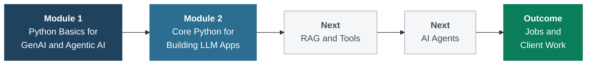
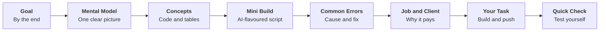
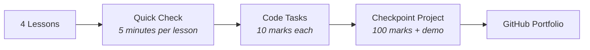
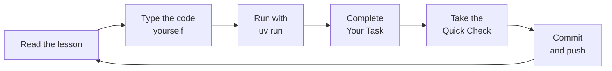

<div align="center">

# Python for AI

### From your first `print()` to AI agents that do real work

A hands-on, project-driven course that teaches Python through the lens of Generative AI and Agentic AI.
Every lesson ends with something you can run, push to GitHub, and show to a client or employer.

<br>


<br>

[Overview](#overview) &nbsp;&middot;&nbsp;
[Learning Path](#the-learning-path) &nbsp;&middot;&nbsp;
[Curriculum](#curriculum) &nbsp;&middot;&nbsp;
[Assessments](#assessments-and-projects) &nbsp;&middot;&nbsp;
[Getting Started](#getting-started) &nbsp;&middot;&nbsp;
[Repository Layout](#repository-layout) &nbsp;&middot;&nbsp;
[Resources](#core-resources)

</div>

---

## Overview

Most Python courses teach the language first and leave AI for "later". This course does the opposite: **every concept is introduced through a real AI use case**. Variables become model configurations, strings become prompts, `if / elif / else` becomes a model router, and a `while` loop becomes a chatbot. By the start of Module 2, that chatbot is talking to a real language model.

The course is built around one idea from Lesson 1.1:

<div align="center">

### `Agent = LLM + Tools + Memory + Loop`

</div>

Each module adds one more piece of that formula, until you can build agents that plan, use tools, and finish tasks on their own.

### Who this course is for

| You are | You will leave with |
|---|---|
| A complete beginner to programming | A solid Python foundation, taught through problems you care about |
| A student aiming for an AI career | A public GitHub portfolio with one commit per lesson |
| A freelancer or aspiring freelancer | Client-style projects you can pitch to local businesses |
| A developer new to GenAI | A practical path from API calls to agents, without the ML theory detour |

### What makes it different

- **Applied AI first.** Industry demand is for engineers who *use* models well, not train them. ML and deep learning can come later, when you need them.
- **Local and private by default.** Lessons run on [Ollama](https://ollama.com), so you can learn for free and offline, then switch to Claude, OpenAI or Gemini with a one-line change.
- **Client-ready mindset.** Every lesson has a *Job & Client Angle* section that connects the skill to paid work.
- **Portfolio from day one.** Every task is pushed to GitHub, so your learning log becomes your proof of skill.

---

## The Learning Path



### One project, growing with you

The course follows a single thread: a customer-support bot for an example business, *Sweet Crumbs bakery*. It starts as a prompt printer, becomes a rule-based chatbot, gets a real AI brain, and ends Module 2 as an agent that uses tools and asks before it acts.

```mermaid
flowchart LR
    A["<b>Lesson 1.4</b><br/>Prompt builder<br/><i>input and f-strings</i>"]
    B["<b>Lesson 1.6</b><br/>Prompt cleaner<br/><i>string methods</i>"]
    C["<b>Lesson 1.7</b><br/>Model router<br/><i>if / elif / else</i>"]
    D["<b>Lesson 1.8</b><br/>Rule-based chatbot<br/><i>while loop and memory</i>"]
    E["<b>Lesson 2.1</b><br/>Hybrid AI chatbot<br/><i>rules plus a real LLM</i>"]
    F["<b>Lessons 2.2 to 2.4</b><br/>Memory and real facts<br/><i>lists, dicts, loops</i>"]
    G["<b>Lessons 2.5 to 2.7</b><br/>Saved, safe, structured<br/><i>functions, JSON, schemas</i>"]
    H["<b>Lesson 2.8</b><br/>First AI agent<br/><i>tools and the agent loop</i>"]

    A --> B --> C --> D --> E --> F --> G --> H

    style E fill:#2c6e91,stroke:#2c6e91,color:#ffffff
    style H fill:#0a7d5a,stroke:#0a7d5a,color:#ffffff
```



---

## Curriculum

### Module 1: Python Basics for GenAI and Agentic AI

Build the foundation: tools, project setup, and the core Python that every AI application is made of. The module ends with a working chatbot for a real local business.

| # | Lesson | What you learn | What you build |
|:-:|---|---|---|
| 1.1 | [Welcome to GenAI and Agentic AI](docs/01-python-basics/1.1-welcome-genai-agentic-ai.md) | AI vs GenAI vs Agentic AI, tokens, hallucinations, why Python, jobs and gigs | Your AI career intro script |
| 1.2 | [Setting Up Your AI Dev Toolkit](docs/01-python-basics/1.2-setting-up-ai-dev-toolkit.md) | uv, Python 3.13, VS Code or Antigravity, Git and GitHub, Ollama, Claude Code | A fully verified dev environment |
| 1.3 | [Your First Python Project with uv](docs/01-python-basics/1.3-first-python-project-with-uv.md) | `pyproject.toml`, `.venv`, `uv.lock`, `uv run`, `uv add`, pushing to GitHub | A clean, reproducible `python-ai` repo |
| 1.4 | [Talking to Python: print, input and Comments](docs/01-python-basics/1.4-print-input-comments.md) | Input, process, output; f-strings; multi-line prompts; writing "why" comments | Prompt builder |
| 1.5 | [Variables and Data Types](docs/01-python-basics/1.5-variables-data-types.md) | `str`, `int`, `float`, `bool`, `None`; casting; naming rules; type hints | AI model config and cost estimator |
| 1.6 | [Working with Text (Strings)](docs/01-python-basics/1.6-working-with-text-strings.md) | Indexing, slicing, string methods, immutability, f-string formatting | Prompt cleaner with token estimate |
| 1.7 | [Operators and Making Decisions](docs/01-python-basics/1.7-operators-and-decisions.md) | Arithmetic, comparison and logical operators; truthiness; `if / elif / else` | Smart model router |
| 1.8 | [Mini Project: Rule-Based Chatbot](docs/01-python-basics/1.8-mini-project-rule-based-chatbot.md) | `while True`, `break`, counters, rule order, designing intents | Business helper bot (Module 1 final) |

### Module 2: Core Python for Building LLM Apps

Connect Python to real language models, then learn the data structures, functions, files and control flow that real LLM apps depend on. The module ends with your first AI agent, built by hand: `Agent = LLM + Tools + Memory + Loop`.

| # | Lesson | What you learn | What you build |
|:-:|---|---|---|
| 2.1 | [Your First AI Call](docs/02-talk-to-ai/2.1-your-first-ai-call.md) | LangChain `init_chat_model`, `invoke`, token usage, system messages, temperature, streaming | AI tutor, and the Module 1 bot with a real AI brain |
| 2.2 | [Chat History with Lists](docs/02-talk-to-ai/2.2-chat-history-with-lists.md) | Lists, indexing, `append`, the messages list, memory cost, trimming with slices | Personal tutor with memory |
| 2.3 | [Messages are Dictionaries](docs/02-talk-to-ai/2.3-messages-are-dictionaries.md) | Dictionaries, `.get()`, nested data, grounding the AI with real facts, personas | Persona bot with real facts |
| 2.4 | [Loops that Talk](docs/02-talk-to-ai/2.4-loops-that-talk.md) | `for` loops, `range`, `.items()`, `continue`, accumulators, `enumerate`, bot evaluation | Batch product writer |
| 2.5 | [Functions = Reusable AI Skills](docs/02-talk-to-ai/2.5-functions-reusable-ai-skills.md) | `def`, parameters, defaults, `return`, scope, docstrings, `assert` tests, AI skills | AI skills toolkit |
| 2.6 | [Files, JSON and Errors](docs/02-talk-to-ai/2.6-files-json-and-errors.md) | Text and JSON files, `try / except`, connection and model errors, logs, privacy | Saved bot that never crashes |
| 2.7 | [Structured Output](docs/02-talk-to-ai/2.7-structured-output.md) | JSON mode, JSON schemas, temperature 0, checking AI data, catching hallucinations | WhatsApp order extractor |
| 2.8 | [Your First Agent](docs/02-talk-to-ai/2.8-your-first-agent.md) | `@tool`, `bind_tools`, tool calls, the agent loop, `MAX_STEPS`, guardrails, human approval | Bakery agent with three tools (Module 2 final) |

> The course is released module by module. Watch or star the repository to follow new lessons as they are published.

---

## Inside Every Lesson

Each lesson follows the same structure, so you always know where to look.



| Section | Purpose |
|---|---|
| **By the end** | A one-sentence promise of what you will be able to do |
| **Mental model** | A simple analogy that makes the concept stick |
| **Mini build** | A short, complete script tied to a real AI use case |
| **Common errors** | The exact error messages beginners hit, with causes and fixes |
| **Job and client angle** | How the skill shows up in jobs, freelancing and client work |
| **Your task** | A self-created exercise you commit and push to GitHub |
| **Key takeaways and quick check** | A five-point summary and three questions to confirm understanding |
| **Must-have resources** | Official documentation and the best references for going deeper |

---

## Assessments and Projects

Every module is split into **checkpoints** of four lessons. Each checkpoint has three assessments: a quick check, code tasks and a client-style project with a live demo.



| Assessment | What it does |
|---|---|
| **Quick check** | Five multiple-choice questions plus one *Predict the Output* per lesson. New examples, not the lesson's own, so it tests understanding rather than memory. Answer without notes or AI tools first, then run the code to check yourself. |
| **Code tasks** | The full spec for each lesson's *Your Task*: client story, requirements, expected output, checklist and marks. Each task is pushed as a single commit. |
| **Project** | Starts with a client story, combines every lesson in the checkpoint, is marked out of 100, and ends with a three-minute demo pitched like a freelancer. |

### Module 1

| Checkpoint | Lessons | Quick check | Code tasks | Project |
|---|---|---|---|---|
| 1 | 1.1 to 1.4 | [Quick Check 1](docs/assessments/module-1/checkpoint-1-quick-checks.md) | [Tasks 1.1 to 1.4](docs/assessments/module-1/checkpoint-1-code-tasks.md) | [AI Prompt Kit for a Local Business](docs/assessments/module-1/checkpoint-1-project-prompt-kit.md) |
| 2 | 1.5 to 1.8 | [Quick Check 2](docs/assessments/module-1/checkpoint-2-quick-checks.md) | [Tasks 1.5 to 1.8](docs/assessments/module-1/checkpoint-2-code-tasks.md) | [AI Front Desk for a Local Business](docs/assessments/module-1/checkpoint-2-project-front-desk.md) |

- **Checkpoint 1 project:** a tool that turns a business's details into three ready-to-use AI prompts, tested on a real model.
- **Checkpoint 2 project (Module 1 final):** a front desk that answers FAQs with rules, calculates exact price quotes, routes other questions to a local or cloud model, and prints a session report.

### Module 2

| Checkpoint | Lessons | Quick check | Code tasks | Project |
|---|---|---|---|---|
| 1 | 2.1 to 2.4 | [Quick Check 1](docs/assessments/module-2/checkpoint-1-quick-checks.md) | [Tasks 2.1 to 2.4](docs/assessments/module-2/checkpoint-1-code-tasks.md) | [AI Content Studio for a Local Business](docs/assessments/module-2/checkpoint-1-project-content-studio.md) |
| 2 | 2.5 to 2.8 | [Quick Check 2](docs/assessments/module-2/checkpoint-2-quick-checks.md) | [Tasks 2.5 to 2.8](docs/assessments/module-2/checkpoint-2-code-tasks.md) | [AI Business Assistant](docs/assessments/module-2/checkpoint-2-project-business-assistant.md) |

- **Checkpoint 1 project:** a content studio that writes a whole menu in one batch, streams social media posts in different tones, answers prices from real data, and chats with memory grounded in the owner's facts.
- **Checkpoint 2 project (Module 2 final):** an agent that answers from the owner's JSON file, checks and places orders with tools after the owner approves, turns WhatsApp messages into checked orders, saves everything, and never crashes.

**Project marking at a glance**

| Score | Level |
|:-:|---|
| 85 to 100 | Client-ready |
| 70 to 84 | Strong, minor fixes |
| 50 to 69 | Working, needs polish |
| Below 50 | Redo and resubmit |

AI tools are allowed throughout the course, but you must be able to explain every line you submit. A project you cannot explain in the demo is capped at 50 marks.

---

## Getting Started

### Prerequisites

| Tool | Purpose | Verify with |
|---|---|---|
| [uv](https://docs.astral.sh/uv) | Installs Python and packages, manages the project | `uv --version` |
| [Python 3.13](https://www.python.org) | The language (installed through uv) | `uv run python --version` |
| [VS Code](https://code.visualstudio.com) or [Antigravity](https://antigravity.google) | Code editor | `code --version` |
| [Git](https://git-scm.com) and a [GitHub](https://github.com) account | Version control and portfolio | `git --version` |
| [Ollama](https://ollama.com/download) | Run AI models locally, for free | `ollama --version` |
| [Claude Code](https://docs.claude.com/en/docs/claude-code) (optional) | AI coding agent in the terminal | `claude --version` |

Full installation steps for macOS, Linux and Windows are in [Lesson 1.2](docs/01-python-basics/1.2-setting-up-ai-dev-toolkit.md).

### Quick start

**1. Clone the repository and install dependencies**

```bash
git clone https://github.com/the-schoolofai/python-ai.git
cd python-ai
uv sync
```

**2. Run the first script**

```bash
uv run main.py
```

**3. Prepare for Module 2 (AI calls)**

```bash
ollama pull llama3.2           # about 2 GB; use llama3.2:1b on 8 GB RAM laptops
uv add langchain langchain-ollama httpx
```

**4. Start learning**

Open [Lesson 1.1](docs/01-python-basics/1.1-welcome-genai-agentic-ai.md) and work through the lessons in order.

> **Tip:** always run code with `uv run`. It uses the project's own virtual environment, even if you forget to activate it.

### Recommended workflow



Use AI coding assistants to *explain*, not to skip learning. Ask for an explanation, then type the code yourself.

---

## Repository Layout

```text
python-ai/
├── code/                         Lesson and project scripts (.py)
│   └── lesson_01_intro.py
├── docs/
│   ├── 01-python-basics/         Module 1 lessons (1.1 to 1.8)
│   ├── 02-talk-to-ai/            Module 2 lessons (2.1 to 2.8)
│   └── assessments/
│       ├── module-1/             Checkpoints 1 and 2: quick checks, code tasks, projects
│       └── module-2/             Checkpoints 1 and 2: quick checks, code tasks, projects
├── notebooks/                    Jupyter notebooks (.ipynb)
├── main.py                       First script
├── pyproject.toml                Project definition and dependencies
├── uv.lock                       Exact dependency versions
├── .python-version               Pinned Python version (3.13)
├── LICENSE                       MIT License
└── README.md                     You are here
```

### File naming conventions

| Item | Convention | Example |
|---|---|---|
| Lesson scripts | `code/lesson_<NN>_<topic>.py` | `code/lesson_05_variables.py` |
| Module 2 scripts | `code/lesson_<M>_<N>_<topic>.py` | `code/lesson_2_1_first_ai_call.py` |
| Project scripts | `code/project_m<M>_<name>.py` | `code/project_m2_business_assistant.py` |
| Data files | `code/<name>.json` | `code/faq.json`, `code/business.json` |
| Commit messages | `Task <N>: <short description>` | `Task 1.5: model profile card` |

---

## Tech Stack

| Layer | Technology | Why it was chosen |
|---|---|---|
| Language | Python 3.13 | A stable release that AI libraries fully support |
| Project and packages | uv | One fast tool for Python versions, environments and lock files |
| LLM framework | LangChain | The same code works across Ollama, Claude, OpenAI and Gemini |
| Local models | Ollama (Llama 3.2) | Free, private and offline, ideal for learning and sensitive client data |
| Notebooks | Jupyter (ipykernel) | Interactive experiments inside VS Code |
| Version control | Git and GitHub | Team collaboration and a public portfolio |

---

## Core Resources

| Topic | Resource |
|---|---|
| Python | [Official tutorial](https://docs.python.org/3/tutorial/) |
| uv | [Documentation](https://docs.astral.sh/uv) |
| LangChain | [Models guide](https://docs.langchain.com/oss/python/langchain/models) and [Ollama integration](https://docs.langchain.com/oss/python/integrations/chat/ollama) |
| Ollama | [Model library](https://ollama.com/library) |
| Prompting | [Prompt engineering overview (Anthropic)](https://docs.claude.com/en/docs/build-with-claude/prompt-engineering/overview) |
| Agents | [Building effective agents (Anthropic)](https://www.anthropic.com/engineering/building-effective-agents) |
| Tools for agents | [Model Context Protocol](https://modelcontextprotocol.io) |
| Further study | [DeepLearning.AI short courses](https://www.deeplearning.ai/short-courses) |

---

## License

This project is released under the [MIT License](LICENSE). You are free to use, adapt and share the lessons and code, provided the copyright notice is kept.

---

<div align="center">

**Python for AI** is created by **Rizwan** at **[The School of AI](https://github.com/the-schoolofai)**.

Clients pay for outcomes, not code. Learn to deliver both.


## Task 1.8: City Care Bot Design

| Intent | User wants | Keywords | Reply |
|---|---|---|---|
| Complaint | To report a problem | late, problem, complaint, wrong | Sorry about that. The clinic manager will call you today. |
| Greeting | To say hello | hi, hello (exact word) | Hello! How can I help you? |
| Timings | Opening hours | timing, hours, open | We are open 10 am to 8 pm, Monday to Saturday. |
| Fees | Consultation price | fee, price, cost | Consultation fee is 2,000 PKR. |
| Location | Where the clinic is | where, location, address | We are on Main Boulevard, Lahore. |
| Appointment | To book a visit | appointment, book | Call 0300-0000000 to book an appointment. |

</div>
