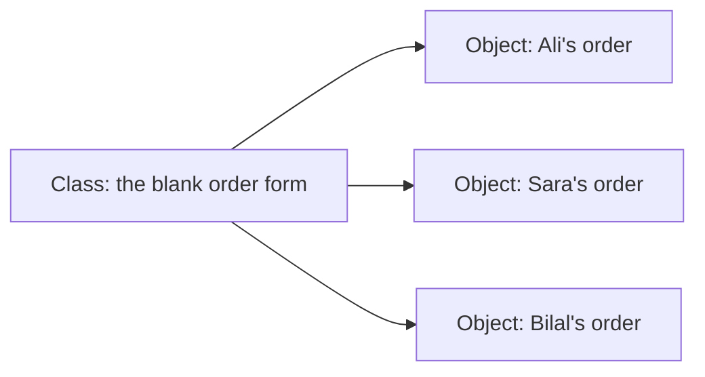
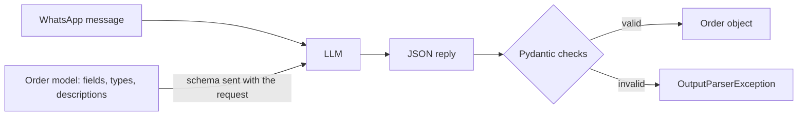

# Lesson 3.2: Classes and Pydantic Models

**Course:** Python for AI · **Module 3:** RAG and Tools · **Updated:** Oct 2026

> **By the end:** You can write your own classes with attributes and methods, describe data with Pydantic models that reject bad values the moment they arrive, and make the AI return a real `Order` object instead of loose JSON. This replaces the schema dictionaries and manual checks from Lesson 2.7.

---

## 1. Mental Model: A Class is a Printed Form

A bakery prints one **order form** (the blueprint). Every customer fills in their own copy (an object). Each copy has the same boxes, but different answers.



A **Pydantic model** is a form with rules printed on it: "Quantity: a whole number, at least 1". If someone writes "five" or "0", the form is rejected at the counter, before it reaches the kitchen.

| Word | Meaning | Bakery example |
|---|---|---|
| **Class** | The blueprint | The blank order form |
| **Object** (instance) | One thing made from the class | Ali's filled-in form |
| **Attribute** | A value stored in the object | `ali.customer`, `ali.items` |
| **Method** | A function that belongs to the class | `ali.total(prices)` |

You have used objects since Lesson 2.1: `response` is an `AIMessage` object, `response.text` is an attribute, and `llm.invoke()` is a method. Today you make your own.

---

## 2. Your First Class

`code/lesson_3_2_cart.py`

```python
"""Lesson 3.2: a plain class: one blueprint, many shopping carts."""


class Cart:
    """A customer's shopping cart."""

    def __init__(self, customer: str):
        self.customer = customer
        self.items = {}  # item name -> quantity

    def add(self, item: str, quantity: int = 1):
        """Add an item, or more of an item already in the cart."""
        self.items[item] = self.items.get(item, 0) + quantity

    def total(self, prices: dict) -> int:
        """Return the cart total in PKR using the given price list."""
        total = 0
        for item, quantity in self.items.items():
            total += prices[item] * quantity
        return total


PRICES = {"chocolate cake": 1500, "cupcake": 250, "brownie": 300}

ali = Cart("Ali")
ali.add("cupcake", 2)
ali.add("cupcake")
sara = Cart("Sara")
sara.add("chocolate cake")

print(ali.customer, ali.items, ali.total(PRICES))     # Ali {'cupcake': 3} 750
print(sara.customer, sara.items, sara.total(PRICES))  # Sara {'chocolate cake': 1} 1500
print(type(ali).__name__)                             # Cart
```

| Part | Meaning |
|---|---|
| `class Cart:` | Define a class. Class names use `CapitalWords`, not `snake_case` |
| `__init__` | Runs automatically when you create an object: `Cart("Ali")` |
| `self` | "This object". Python passes it in for you: `ali.add("cupcake")` runs `add` with `self = ali` |
| `self.customer = customer` | Store a value **inside** the object, so every method can use it |
| `ali` and `sara` | Two objects from one class. Each has its **own** `items`: adding to Ali's cart does not touch Sara's |

**Rule:** every method's first parameter is `self`. You never pass it yourself.

---

## 3. Why Plain Classes Are Not Enough for AI Data

```python
bad = Cart(42)            # a number as the customer name: no error
bad.add("pizza", -3)      # not on the menu, negative quantity: no error
bad.total(PRICES)         # KeyError: 'pizza', far away from the real mistake
```

A plain class stores **anything**. With AI output, "anything" happens daily: `"quantity": "five"`, a missing name, a quantity of `0`. You want the error **at the door**, with a clear message, not three functions later.

---

## 4. Pydantic: A Class That Checks Its Data

Pydantic comes with LangChain (it is what raised `ValidationError` in your Lesson 2.8 tools). Run `uv add pydantic` so it is listed in your `pyproject.toml` too.

`code/lesson_3_2_pydantic.py`

```python
"""Lesson 3.2: Pydantic models check data the moment it is created."""

from pydantic import BaseModel, Field, ValidationError


class OrderItem(BaseModel):
    """One line of an order."""

    name: str
    quantity: int = Field(gt=0, description="How many, at least 1")


item = OrderItem(name="cupcake", quantity="3")  # "3" is safely converted to 3
print(item)                  # name='cupcake' quantity=3
print(item.quantity + 1)     # 4
print(item.model_dump())     # {'name': 'cupcake', 'quantity': 3}

for data in [{"name": "brownie", "quantity": 0}, {"name": "brownie", "quantity": "five"}, {"quantity": 2}]:
    try:
        OrderItem(**data)
    except ValidationError as e:
        problem = e.errors()[0]
        print(f"Rejected {data}: {problem['loc'][0]}: {problem['msg']}")
```

**Output**
```text
name='cupcake' quantity=3
4
{'name': 'cupcake', 'quantity': 3}
Rejected {'name': 'brownie', 'quantity': 0}: quantity: Input should be greater than 0
Rejected {'name': 'brownie', 'quantity': 'five'}: quantity: Input should be a valid integer, unable to parse string as an integer
Rejected {'quantity': 2}: name: Field required
```

| Part | Meaning |
|---|---|
| `class OrderItem(BaseModel):` | A Pydantic model: a class that **inherits** all of Pydantic's checking |
| `name: str` | A field with a type hint (Lesson 1.5). No `__init__` needed: Pydantic writes it for you |
| `Field(gt=0, description=...)` | A rule (`gt` = greater than) and a description the **AI will read** |
| `OrderItem(**data)` | `**` unpacks a dictionary into named arguments: `OrderItem(name="brownie", quantity=0)` |
| `e.errors()` | A list of problems; each has `loc` (which field) and `msg` (what is wrong) |

**Common `Field` rules**

| Rule | Meaning | Example |
|---|---|---|
| `gt=0` / `ge=1` | Greater than / greater or equal | Quantity at least 1 |
| `le=5` | Less or equal | A rating from 1 to 5 |
| `min_length=2` / `max_length=500` | Text length limits | A name, a review |
| `default=""` | Optional field with a default | Address may be missing |
| `description="..."` | Explains the field | Sent to the AI as part of the schema |

**Moving data in and out**

| Method | Does | Use for |
|---|---|---|
| `item.model_dump()` | Object to `dict` | Saving with `json.dump` |
| `item.model_dump_json()` | Object to JSON text | Sending to an API |
| `OrderItem.model_validate(data)` | `dict` to checked object | Loading `orders.json` back |
| `OrderItem.model_validate_json(text)` | JSON text to checked object | Reading an API reply |

---

## 5. Models Inside Models, with Methods

An order has many items, so a model can hold a **list of other models**. And because a Pydantic model is a class, it can have **methods**. Create `code/sweet_crumbs/models.py`:

```python
"""Data models: the exact shape of an order, checked by Pydantic."""

from pydantic import BaseModel, Field


class OrderItem(BaseModel):
    """One line of an order."""

    name: str = Field(description="Item name, exactly as on the menu")
    quantity: int = Field(gt=0, description="How many, at least 1")


class Order(BaseModel):
    """A customer order taken from a chat message."""

    customer: str = Field(description="The customer's name, or an empty string if it is not in the message")
    items: list[OrderItem] = Field(description="Every item ordered; an empty list if the message is not an order")
    address: str = Field(description="Delivery address, or an empty string if it is not in the message")

    def total(self, prices: dict) -> int:
        """Return the order total in PKR, counting only items on the menu."""
        total = 0
        for item in self.items:
            name = item.name.lower()
            if name in prices:
                total += prices[name] * item.quantity
        return total

    def problems(self, prices: dict, message: str) -> list:
        """Return every reason a human should check this order."""
        found = []
        for item in self.items:
            if item.name.lower() not in prices:
                found.append(f"'{item.name}' is not on the menu")
        if self.customer == "":
            found.append("customer name is missing")
        elif self.customer.lower() not in message.lower():
            found.append(f"customer '{self.customer}' is not in the message (invented?)")
        return found


if __name__ == "__main__":
    test = Order(customer="Ali", items=[OrderItem(name="Cupcake", quantity=2), OrderItem(name="pizza", quantity=1)], address="")
    prices = {"cupcake": 250}
    assert test.total(prices) == 500
    assert test.problems(prices, "2 cupcakes and a pizza, Ali") == ["'pizza' is not on the menu"]
    assert Order(customer="Ahmed", items=[], address="").problems(prices, "hi") == ["customer 'Ahmed' is not in the message (invented?)"]
    print("models.py: all tests passed")
```

```bash
cd code
uv run python -m sweet_crumbs.models   # models.py: all tests passed
```

**Mental model:** the **model** checks the **shape** (types, required fields, quantity at least 1). The **methods** check the **business rules** (on the menu? name really in the message?). Lesson 2.7 did both by hand in the main loop; now each rule lives in one tested place.

---

## 6. The AI Fills In Your Model: `with_structured_output`

In Lesson 2.7 you wrote a schema dictionary, called `json.loads`, then read every key with `.get()`. Now one line does all of it:

```python
extractor = llm.with_structured_output(Order)
order = extractor.invoke("2 cupcakes for Ali, Gulberg")

print(type(order).__name__)   # Order
print(order.items[0].quantity) # 2: a real int, already checked
```



| Lesson 2.7 (by hand) | Lesson 3.2 (Pydantic) |
|---|---|
| A schema `dict`, written by hand | The `Order` class **is** the schema |
| `json.loads(response.text)` + `json.JSONDecodeError` | Done for you |
| `order.get("customer", "")` everywhere | `order.customer`, with your editor's autocomplete |
| Quantity could be `"five"` or `0` | Rejected by the model's rules |
| Checks scattered in the main loop | `order.problems(...)` and `order.total(...)`, tested |

**If the reply does not fit the model** (not JSON, a missing field, quantity `0`), `invoke` raises `OutputParserException` from `langchain_core.exceptions`. Catch it and send the message to a human. The **descriptions** in your `Field`s travel with the request, so write them like instructions to a new staff member.

---

## 7. Mini Build: WhatsApp Orders as `Order` Objects

The Lesson 2.7 extractor, rebuilt on the Lesson 3.1 package. `code/lesson_3_2_order_models.py`:

```python
"""Lesson 3.2: WhatsApp orders in, checked Order objects out. Run: uv run lesson_3_2_order_models.py"""

import json

from langchain.chat_models import init_chat_model
from langchain_core.exceptions import OutputParserException

from sweet_crumbs.config import MODEL, PROVIDER
from sweet_crumbs.data import PRICES
from sweet_crumbs.models import Order

llm = init_chat_model(MODEL, model_provider=PROVIDER, temperature=0)
# The model must return an Order: LangChain sends the schema and builds the object for us
extractor = llm.with_structured_output(Order)

SYSTEM = (
    "Extract the bakery order from the WhatsApp message. "
    f"Item names must be one of: {', '.join(PRICES)}. Never invent details."
)

messages_in = [
    "Salam! 2 cupcakes aur 1 chocolate cake chahiye. Ali, house 12 Gulberg",
    "1 pizza and 2 brownies please, Model Town",
    "hi do you deliver to Johar Town?",
    "zero brownies please, just testing the bot. Sara",
]

saved = []

for message in messages_in:
    print(f"\nMessage: {message}")
    try:
        order = extractor.invoke([{"role": "system", "content": SYSTEM}, {"role": "user", "content": message}])
    except OutputParserException:
        # The reply was not valid JSON, or broke a rule in the model (for example quantity 0)
        print("  CHECK: the AI reply did not fit the Order model. Enter this one by hand.")
        continue

    if len(order.items) == 0:
        print("  Not an order: needs a human reply.")
        continue

    for item in order.items:
        print(f"  {item.quantity} x {item.name}")
    print(f"  Customer: {order.customer or '(missing)'}, Address: {order.address or '(missing)'}")
    print(f"  Total: {order.total(PRICES):,} PKR")
    for problem in order.problems(PRICES, message):
        print(f"  CHECK: {problem}")

    # model_dump() turns the object back into a plain dictionary that JSON can save
    row = order.model_dump()
    row["total"] = order.total(PRICES)
    saved.append(row)

with open("orders.json", "w", encoding="utf-8") as f:
    json.dump(saved, f, indent=2, ensure_ascii=False)
print(f"\nSaved {len(saved)} orders to orders.json")
```

**Example run (AI extraction will differ)**
```text
Message: Salam! 2 cupcakes aur 1 chocolate cake chahiye. Ali, house 12 Gulberg
  2 x cupcake
  1 x chocolate cake
  Customer: Ali, Address: house 12 Gulberg
  Total: 2,000 PKR

Message: 1 pizza and 2 brownies please, Model Town
  1 x Pizza
  2 x Brownie
  Customer: Bilal, Address: Model Town
  Total: 600 PKR
  CHECK: 'Pizza' is not on the menu
  CHECK: customer 'Bilal' is not in the message (invented?)

Message: hi do you deliver to Johar Town?
  Not an order: needs a human reply.

Message: zero brownies please, just testing the bot. Sara
  CHECK: the AI reply did not fit the Order model. Enter this one by hand.

Saved 2 orders to orders.json
```

**Try it in class:**
1. Remove `Field(gt=0, ...)` from `quantity`, run again: what happens to the "zero brownies" message now?
2. Rewrite the `customer` description to be vague ("the name"). Does the AI start inventing names more often?
3. Add `phone: str = Field(default="", description=...)` to `Order`. Without touching the main script, every saved order now has a phone field

---

## 8. Common Errors and Traps

| Problem | Cause | Fix |
|---|---|---|
| `TypeError: Cart.__init__() missing 1 required positional argument: 'customer'` | Created the object without the value `__init__` needs | `Cart("Ali")` |
| `TypeError: Cart.add() takes 1 positional argument but 2 were given` | Forgot `self` in the method: `def add(item):` | First parameter is always `self` |
| `NameError: name 'items' is not defined` inside a method | Used `items` instead of `self.items` | Attributes are read through `self.` |
| `AttributeError: 'Cart' object has no attribute 'itms'` | Typo in an attribute name | Check the spelling against `__init__` |
| `ValidationError: ... Field required` | A required field is missing | Pass it, or give it a `default` |
| `ValidationError: ... Input should be a valid integer` | Wrong type that Pydantic cannot convert (`"five"`) | Fix the data, or catch `ValidationError` and ask a human |
| `TypeError: Object of type Order is not JSON serializable` | `json.dump` on a model object | Save `order.model_dump()` instead |
| `OutputParserException` from `with_structured_output` | The AI reply was not valid JSON, or broke a model rule | Catch it and send that message to a human |
| A rule is skipped after you change a value: `item.quantity = -5` works | Pydantic checks on **creation**, not on later changes | Create a new object, or add `model_config = ConfigDict(validate_assignment=True)` to the model |
| `item["name"]` gives `TypeError: 'OrderItem' object is not subscriptable` | Treated an object like a dictionary | Use `item.name` (or `item.model_dump()["name"]`) |

---

## 9. Job & Client Angle

- **"Typed, validated data" is how real AI products are built.** Extraction, form filling, lead capture and invoice reading all use a Pydantic model as the contract between the AI and the rest of the system.
- **Models are documentation.** A client's developer reads `models.py` and knows exactly what an order looks like, with no guessing and no outdated notes.
- **Switching providers stays safe.** The same `Order` model works with Ollama, Claude or OpenAI through `with_structured_output`, so your checks never change when the model does.

---

## 10. Your Task (self-create)

Add a `models.py` to **your own** Lesson 3.1 package: a Pydantic model for the main thing your business receives (an order, a booking, an appointment, a lead) with at least one nested model, rules and descriptions on every field, methods for your business rules with `if __name__ == "__main__":` tests, and an extractor script that turns messy messages into checked objects with `with_structured_output`.

**Full requirements, expected output, stretch goal and marking:** [Task 3.2: Booking Models](../assessments/module-3/checkpoint-1-code-tasks.md#task-32-booking-models)

Run it with `uv run lesson_3_2_order_models.py` from the `code` folder, then push.

---

## Key Takeaways

- A **class** is a blueprint; an **object** is one copy with its own **attributes**; **methods** are functions that use `self`
- A **Pydantic model** (`BaseModel`) checks types and rules the moment data arrives, and raises `ValidationError` with clear messages
- `Field(...)` adds rules (`gt`, `le`, `max_length`) and descriptions the AI reads
- `llm.with_structured_output(Model)` makes the AI return a checked object; catch `OutputParserException` when it cannot
- The model checks the **shape**; methods check the **business rules**; `model_dump()` turns it back into a dictionary to save

### Quick Check
1. What does `self` mean inside a method, and who passes it?
2. Why is `quantity: int = Field(gt=0)` better than checking the quantity later in the main loop?
3. What do you save to JSON: the `Order` object or `order.model_dump()`? Why?

---

## Must-Have Resources

- Python tutorial, classes: https://docs.python.org/3/tutorial/classes.html
- Pydantic, models: https://docs.pydantic.dev/latest/concepts/models/
- Pydantic, fields and rules: https://docs.pydantic.dev/latest/concepts/fields/
- LangChain, structured output from a model: https://docs.langchain.com/oss/python/langchain/models#structured-output
- Real Python, object-oriented programming in Python: https://realpython.com/python3-object-oriented-programming/

**Next:** Lesson 3.3: Calling Web APIs
