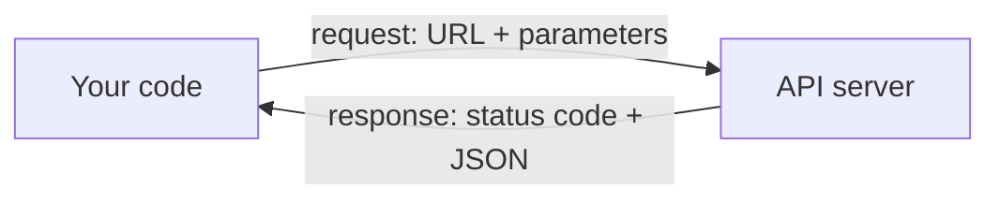
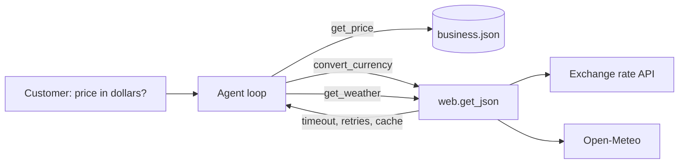

# Lesson 3.3: Calling Web APIs

**Course:** Python for AI · **Module 3:** RAG and Tools · **Updated:** Oct 2026

> **By the end:** You can get live data from any web API with `httpx`, read status codes, set timeouts, retry only the failures that can fix themselves, and turn an API into a **tool** your agent uses. Your bakery agent will quote prices in US dollars or dirhams at today's rate, and check the weather before promising a delivery.

---

## 1. Mental Model: An API is a Takeaway Counter

You do not walk into the kitchen. You go to the counter, order from the menu in the exact format they expect, and get back a box with a receipt.



| At the counter | In code |
|---|---|
| The counter's address | The **URL**: `https://open.er-api.com/v6/latest/USD` |
| Your order details | **Parameters**: `?latitude=31.55&longitude=74.34` |
| "Here you go" or "sorry, sold out" | The **status code**: `200`, `404`, `429` ... |
| The box | The **body**, almost always **JSON** (Lesson 2.6) |
| "Come back in 10 minutes" | A **timeout** and a **retry** |

**Why AI apps need this:** a model only knows what it learned during training. It does not know today's exchange rate or the weather. Your agent gets live facts by calling an API through a tool (Lesson 2.8).

**The two free APIs in this lesson** (no sign-up, no key):

| API | Gives you | Rules |
|---|---|---|
| [ExchangeRate-API, open access](https://www.exchangerate-api.com/docs/free) | Today's exchange rates, including PKR, AED, USD, GBP, SAR | Updates once a day; call at most about once an hour or you get `429`; show "Rates By Exchange Rate API" |
| [Open-Meteo](https://open-meteo.com) | Current weather and city coordinates | Free for **non-commercial** use, under 10,000 calls a day |

---

## 2. Your First API Call

```bash
uv add httpx
```

`httpx` already came with LangChain (Lesson 2.6); adding it lists it in your `pyproject.toml`.

`code/lesson_3_3_first_call.py`

```python
"""Lesson 3.3: your first web API call: today's US dollar rate in rupees."""

import httpx

response = httpx.get("https://open.er-api.com/v6/latest/USD", timeout=10)

print(response.status_code)            # 200
data = response.json()                 # JSON text -> Python dictionary
print(data["result"])                  # success
print(data["base_code"])               # USD
print(data["rates"]["PKR"])            # for example 281.45
print(data["time_last_update_utc"])    # when the rate was last updated
```

| Part | Meaning |
|---|---|
| `httpx.get(url, timeout=10)` | Send a GET request ("give me this"), and wait at most 10 seconds |
| `response.status_code` | `200` means it worked |
| `response.json()` | Turns the JSON text into a dictionary, like `json.loads` (Lesson 2.6) |
| `data["rates"]["PKR"]` | Nested data, read from the outside in (Lesson 2.3) |
| `response.text` | The raw text, useful when something goes wrong |

**Try it in a browser first:** open `https://open.er-api.com/v6/latest/USD`. You see the same JSON your code receives. Pros always look at the raw answer before writing code for it.

---

## 3. Parameters: Let `httpx` Build the URL

Many APIs take their inputs as **query parameters** after a `?`. Pass a dictionary with `params=` and `httpx` writes the URL correctly, including commas and spaces.

`code/lesson_3_3_params.py`

```python
"""Lesson 3.3: send parameters, check the status, and read nested JSON."""

import httpx

response = httpx.get(
    "https://api.open-meteo.com/v1/forecast",
    params={"latitude": 31.558, "longitude": 74.3507, "current": "temperature_2m,wind_speed_10m"},
    timeout=10,
)
print(response.url)   # httpx builds the full URL with ?latitude=...&longitude=...

if response.status_code == 200:
    current = response.json()["current"]
    units = response.json()["current_units"]
    print(f"Lahore now: {current['temperature_2m']} {units['temperature_2m']}, wind {current['wind_speed_10m']} {units['wind_speed_10m']}")
else:
    print(f"Something went wrong: {response.status_code} {response.text}")
```

**Output (the weather will differ)**
```text
https://api.open-meteo.com/v1/forecast?latitude=31.558&longitude=74.3507&current=temperature_2m%2Cwind_speed_10m
Lahore now: 29.4 °C, wind 7.2 km/h
```

`%2C` is how a comma is written inside a URL. You never have to do this by hand.

---

## 4. Status Codes: Read the Receipt First

| Code | Meaning | Your code should |
|---|---|---|
| **200** | OK | Read the JSON |
| **400** | Bad request: you sent something wrong | Fix the request, do **not** retry |
| **401 / 403** | No key, wrong key, or not allowed | Check your API key in `.env` (Lesson 3.1), do **not** retry |
| **404** | Not found (wrong URL, unknown currency code) | Fix the URL or the input, do **not** retry |
| **429** | Too many requests | Wait, then retry; and call less often (cache) |
| **500, 502, 503, 504** | The server has a problem right now | Wait, then retry |

**Rule of thumb:** `4xx` = **your** mistake (retrying will not help, except 429). `5xx` = **their** problem (it may fix itself).

**Check the answer too.** Some APIs return `200` with an error inside. The exchange rate API sets `"result": "error"` with an `"error-type"`; Open-Meteo returns `400` with `{"error": true, "reason": "..."}`. Read the API's docs once to know which.

---

## 5. The Three Ways a Call Fails

`code/lesson_3_3_errors.py`

```python
"""Lesson 3.3: the three ways a web call fails, and how to catch each one."""

import httpx

try:
    response = httpx.get("https://open.er-api.com/v6/latest/XYZ", timeout=10)
    response.raise_for_status()          # turns a 4xx or 5xx status into an exception
    print(response.json()["rates"]["PKR"])
except httpx.TimeoutException:
    print("The service is too slow right now. Try again in a minute.")
except httpx.ConnectError:
    print("Cannot reach the service. Check your internet connection.")
except httpx.HTTPStatusError as error:
    print(f"The service said no: {error.response.status_code}")
```

**Output** (`XYZ` is not a real currency)
```text
The service said no: 404
```

| Exception | When | Example |
|---|---|---|
| `httpx.TimeoutException` | The server is too slow | No answer within `timeout=10` |
| `httpx.ConnectError` | It cannot be reached at all | No internet, wrong address |
| `httpx.HTTPStatusError` | It answered, but with `4xx` or `5xx` | Raised by `response.raise_for_status()` |
| `httpx.HTTPError` | The parent of all of the above | Catch it last, as a safety net |

**Always set a timeout.** Without one, a slow API can freeze your agent while a customer waits. `httpx` uses 5 seconds by default; set it on purpose.

---

## 6. Retries: Try Again, but Only When It Can Help

A busy server often recovers in seconds. Retry **timeouts, network errors, 429 and 5xx**. Never retry `400`, `401` or `404`: the answer will be the same every time.

`code/lesson_3_3_retry.py`

```python
"""Lesson 3.3: retry only the failures that can fix themselves, waiting longer each time."""

import time

import httpx

URL = "https://open.er-api.com/v6/latest/USD"
RETRY_STATUSES = (429, 500, 502, 503, 504)  # busy or broken for a moment: worth another try

data = {}
for attempt in range(1, 4):
    try:
        response = httpx.get(URL, timeout=10)
        if response.status_code in RETRY_STATUSES:
            print(f"Attempt {attempt}: server busy ({response.status_code})")
        else:
            response.raise_for_status()  # 400, 401, 404: retrying will never fix these
            data = response.json()
            break
    except (httpx.TimeoutException, httpx.ConnectError):
        print(f"Attempt {attempt}: no answer")
    except httpx.HTTPStatusError as error:
        print(f"Refused ({error.response.status_code}): retrying will not help.")
        break
    if attempt < 3:
        time.sleep(2 ** attempt)  # wait 2, then 4 seconds: give the server room to recover

if data:
    print(f"1 USD = {data['rates']['PKR']} PKR")
else:
    print("No rate available right now.")
```

**Output when the server is busy twice, then fine**
```text
Attempt 1: server busy (503)
Attempt 2: server busy (503)
1 USD = 281.45 PKR
```

| Idea | Why |
|---|---|
| `range(1, 4)` | A limit: at most 3 tries, never an endless loop |
| `time.sleep(2 ** attempt)` | **Exponential backoff**: wait 2, then 4 seconds, so a struggling server gets room to recover |
| No sleep after the last attempt | Nothing more to try, so do not make the user wait |
| `break` on success **and** on `4xx` | Stop as soon as more tries cannot change the result |

**Cache what does not change.** The exchange rate updates once a day. Asking for it on every customer message wastes time and gets you a `429`. Save the answer with the time you got it, and reuse it for an hour.

---

## 7. Mini Build: Live Tools for the Sweet Crumbs Agent

The Lesson 3.1 package gets three upgrades: the API addresses in `config.py`, one safe helper for every API call in `web.py`, and two live tools in `live_tools.py`.



### Step 1: `code/sweet_crumbs/config.py` (the new settings are in the middle)

```python
"""Settings for the whole app, read once from .env."""

import os
from pathlib import Path

from dotenv import load_dotenv

load_dotenv()

PROVIDER = os.getenv("PROVIDER", "ollama")
MODEL = os.getenv("MODEL", "llama3.2")
MAX_STEPS = int(os.getenv("MAX_STEPS", "5"))

# The data file sits next to this package, so the app works from any folder
DATA_FILE = Path(__file__).parent.parent / "business.json"

# Web APIs: the addresses live in settings, so a test can point them at a fake server
RATES_URL = os.getenv("RATES_URL", "https://open.er-api.com/v6/latest")
GEOCODE_URL = os.getenv("GEOCODE_URL", "https://geocoding-api.open-meteo.com/v1/search")
WEATHER_URL = os.getenv("WEATHER_URL", "https://api.open-meteo.com/v1/forecast")
HTTP_TIMEOUT = float(os.getenv("HTTP_TIMEOUT", "10"))
CACHE_SECONDS = int(os.getenv("CACHE_SECONDS", "3600"))

# Fail early with a clear message instead of a confusing error on the first question
if PROVIDER == "anthropic" and os.getenv("ANTHROPIC_API_KEY", "") == "":
    raise SystemExit("PROVIDER is anthropic but ANTHROPIC_API_KEY is empty. Add it to your .env file.")
```

**Why the URLs are settings:** in testing you point them at a fake server; with a paid API you switch provider in `.env`, not in code. Add the same names to `.env.example`.

### Step 2: `code/sweet_crumbs/web.py`: one safe way to call any API

```python
"""Web helper: one safe way to get JSON from any API, with a timeout, retries and a cache."""

import time

import httpx

from sweet_crumbs.config import CACHE_SECONDS, HTTP_TIMEOUT

RETRY_STATUSES = (429, 500, 502, 503, 504)  # busy or broken for a moment: worth another try
_cache = {}  # (url, params) -> (time saved, data)


class ApiError(Exception):
    """A web API could not give us an answer. The message is safe to show to a user."""


def get_json(url: str, params: dict | None = None, attempts: int = 3) -> dict:
    """GET a URL and return its JSON as a dictionary, or raise ApiError.

    Retries timeouts, network errors and busy servers (429, 5xx), waiting longer
    each time. Remembers answers for CACHE_SECONDS, so the same question costs
    one call, not one per customer.
    """
    key = (url, str(sorted((params or {}).items())))
    if key in _cache and time.time() - _cache[key][0] < CACHE_SECONDS:
        return _cache[key][1]

    problem = "no answer"
    for attempt in range(1, attempts + 1):
        try:
            response = httpx.get(url, params=params, timeout=HTTP_TIMEOUT)
            if response.status_code in RETRY_STATUSES:
                problem = f"the service is busy ({response.status_code})"
            elif response.status_code != 200:
                # 400, 401, 404 ...: the request itself is wrong, so retrying will not help
                raise ApiError(f"the service refused the request ({response.status_code})")
            else:
                try:
                    data = response.json()
                except ValueError:
                    # For example a Wi-Fi login page: HTML instead of JSON
                    raise ApiError("the service did not send JSON")
                _cache[key] = (time.time(), data)
                return data
        except httpx.TimeoutException:
            problem = "the service did not answer in time"
        except httpx.TransportError:
            # No internet, a blocked proxy, a dropped connection: all are "could not reach it"
            problem = "the service could not be reached (no internet?)"
        if attempt < attempts:
            time.sleep(2 ** (attempt - 1))  # wait 1, then 2 seconds
    raise ApiError(f"{problem}, after {attempts} attempts")


if __name__ == "__main__":
    # Quick check against a real API: uv run python -m sweet_crumbs.web
    rates = get_json("https://open.er-api.com/v6/latest/USD")
    print("1 USD =", rates["rates"]["PKR"], "PKR")
    start = time.time()
    get_json("https://open.er-api.com/v6/latest/USD")
    print(f"Second call came from the cache in {time.time() - start:.4f} seconds")
```

| Part | Why |
|---|---|
| `class ApiError(Exception)` | **Our own** error type (a class that inherits from `Exception`, like `BaseModel` in Lesson 3.2). Tools catch **one** error instead of six |
| `params: dict | None = None` | `params` is optional: a dictionary, or nothing |
| `_cache` | The same question within an hour is answered from memory: faster, and no `429` |
| `httpx.TransportError` | Catches no internet, a blocked proxy and dropped connections. `ConnectError` alone misses a **proxy** block, common on office and university Wi-Fi |
| `except ValueError` around `.json()` | A Wi-Fi login page sends HTML, not JSON |

### Step 3: `code/sweet_crumbs/live_tools.py`: the tools

```python
"""Live tools: currency conversion and weather, from free public APIs.

Rates by Exchange Rate API (https://www.exchangerate-api.com).
Weather by Open-Meteo (https://open-meteo.com), free for non-commercial use.
"""

from langchain.tools import tool
from pydantic import BaseModel, ValidationError

from sweet_crumbs.config import GEOCODE_URL, RATES_URL, WEATHER_URL
from sweet_crumbs.web import ApiError, get_json


class RatesReply(BaseModel):
    """The parts of the exchange rate API's answer we use (Lesson 3.2: check data at the door)."""

    result: str
    base_code: str
    time_last_update_utc: str
    rates: dict[str, float]


def describe_weather(code: int) -> str:
    """Turn a WMO weather code from Open-Meteo into plain words."""
    if code == 0:
        return "clear sky"
    elif code <= 3:
        return "partly cloudy"
    elif code in (45, 48):
        return "fog"
    elif 51 <= code <= 67 or 80 <= code <= 82:
        return "rain"
    elif 71 <= code <= 77 or code in (85, 86):
        return "snow"
    elif code >= 95:
        return "thunderstorm"
    return "unknown weather"


@tool(parse_docstring=True)
def convert_currency(amount: float, from_currency: str, to_currency: str) -> str:
    """Convert an amount of money between currencies, using today's exchange rate.

    Args:
        amount: How much money, for example 1500.
        from_currency: The 3-letter code to convert from, for example "PKR".
        to_currency: The 3-letter code to convert to, for example "USD".
    """
    source = from_currency.upper().strip()
    target = to_currency.upper().strip()
    try:
        reply = RatesReply.model_validate(get_json(f"{RATES_URL}/{source}"))
    except ApiError as error:
        return f"Exchange rates are not available right now: {error}"
    except ValidationError:
        return "The exchange rate service sent an answer in an unexpected format."
    if target not in reply.rates:
        return f"{target} is not a currency code I know. Use a 3-letter code like USD, AED or GBP."
    # Python does the maths, never the AI: money must be exact
    converted = amount * reply.rates[target]
    return (f"{amount:,.2f} {source} = {converted:,.2f} {target} "
            f"(rate {reply.rates[target]:g}, updated {reply.time_last_update_utc}). Rates by Exchange Rate API.")


@tool(parse_docstring=True)
def get_weather(city: str) -> str:
    """Get the current weather in a city, for planning deliveries.

    Args:
        city: The city name, for example "Lahore".
    """
    try:
        places = get_json(GEOCODE_URL, {"name": city, "count": 1})
        # Open-Meteo leaves out "results" when it finds no city, so .get() with a default
        found = places.get("results", [])
        if len(found) == 0:
            return f"I could not find a city called {city}."
        place = found[0]
        forecast = get_json(WEATHER_URL, {
            "latitude": place["latitude"],
            "longitude": place["longitude"],
            "current": "temperature_2m,wind_speed_10m,weather_code",
        })
    except ApiError as error:
        return f"The weather service is not available right now: {error}"
    now = forecast["current"]
    units = forecast["current_units"]
    return (f"{place['name']}, {place['country']}: {now['temperature_2m']}{units['temperature_2m']}, "
            f"{describe_weather(now['weather_code'])}, wind {now['wind_speed_10m']} {units['wind_speed_10m']}.")


if __name__ == "__main__":
    assert describe_weather(0) == "clear sky"
    assert describe_weather(63) == "rain"
    assert describe_weather(95) == "thunderstorm"
    print("live_tools.py: all tests passed")
```

**Three rules every live tool follows**

| Rule | In the code |
|---|---|
| **Never crash the agent.** Return a clear sentence the model can pass on | `except ApiError` returns "not available right now" |
| **Check the data at the door** (Lesson 3.2) | `RatesReply.model_validate(...)` |
| **Python does the maths** | `amount * reply.rates[target]`, never the AI |

### Step 4: add the tools to `code/sweet_crumbs/tools.py`

Two changes to the Lesson 3.1 file: one import at the top, and two new entries in `TOOLS`.

```python
from sweet_crumbs.live_tools import convert_currency, get_weather

TOOLS = {
    "get_price": get_price,
    "order_status": order_status,
    "place_order": place_order,
    "convert_currency": convert_currency,
    "get_weather": get_weather,
}
```

`agent.py` does not change: it already binds whatever is in `TOOLS`.

### Step 5: `code/lesson_3_3_live_agent.py`

```python
"""Lesson 3.3: the Sweet Crumbs agent with live tools: currency and weather. Run: uv run lesson_3_3_live_agent.py"""

from sweet_crumbs.agent import run_agent
from sweet_crumbs.config import MODEL, PROVIDER
from sweet_crumbs.data import business

messages = [{
    "role": "system",
    "content": f"You are the {business['name']} bakery agent in {business['city']}. Prices are in PKR. "
    "Use the tools for prices, order status, new orders, currency conversion and the weather. "
    "For a price in another currency, get the PKR price first, then convert it. "
    "Never guess prices, rates or the weather. Answer in 2 short lines.",
}]

print(f"{business['name']} Agent ({PROVIDER}: {MODEL}). Try: 'How much is a chocolate cake in US dollars?' Type 'bye' to exit.")

while True:
    text = input("You: ").strip()
    if text.lower() == "bye":
        break
    if text == "":
        continue
    messages.append({"role": "user", "content": text})
    print(f"Agent: {run_agent(messages)}")
```

```bash
cd code
uv run python -m sweet_crumbs.live_tools   # live_tools.py: all tests passed
uv run lesson_3_3_live_agent.py
```

**Example run (the model's wording and today's rate will differ)**
```text
You: How much is a chocolate cake in US dollars?
  [tool] get_price({'item': 'chocolate cake'}) -> chocolate cake costs 1500 PKR
  [tool] convert_currency({'amount': 1500, 'from_currency': 'PKR', 'to_currency': 'USD'}) -> 1,500.00 PKR = 5.33 USD (rate 0.003553, updated Mon, 26 Oct 2026 00:02:31 +0000). Rates by Exchange Rate API.
Agent: A chocolate cake is 1,500 PKR, which is about 5.33 USD at today's rate.
You: Will it rain in Karachi today?
  [tool] get_weather({'city': 'Karachi'}) -> Karachi, Pakistan: 31.2°C, rain, wind 14.8 km/h.
Agent: Yes, it is raining in Karachi right now, so deliveries there may be a little late.
```

**Try it in class:**
1. Ask for a price in dirhams: does the agent call `get_price` **and then** `convert_currency`?
2. Turn off your Wi-Fi and ask again: the agent should say rates are not available, not crash
3. Ask the same currency question twice and time it: the second answer comes from the cache
4. Ask for the weather in a city that does not exist

---

## 8. Common Errors and Traps

| Problem | Cause | Fix |
|---|---|---|
| `httpx.ConnectError: [Errno 111] Connection refused` or `Name or service not known` | No internet, or a typo in the URL | Check the connection and the URL in a browser |
| `httpx.ProxyError: 403 Forbidden` | A company or campus network blocks the site | Use another network, or ask the network admin; catch `httpx.TransportError` |
| `httpx.ReadTimeout` | The server is slow | Set `timeout=`, retry with backoff |
| `httpx.UnsupportedProtocol: Request URL is missing an 'http://' or 'https://' protocol` | URL without `https://` | Write the full URL |
| `json.JSONDecodeError` from `response.json()` | The answer is HTML (an error page or a Wi-Fi login page) | Check `response.status_code` and `response.text` first |
| `KeyError: 'rates'` or `KeyError: 'results'` | An error answer, or "nothing found" has a different shape | Check `result` / status first; use `.get("results", [])` |
| Status `429` | Too many calls | Cache the answer; call at most once an hour for daily data |
| Status `401` | Missing or wrong API key | Put the key in `.env`, send it the way the API's docs say, never in the code |
| The agent guesses a rate instead of calling the tool | Weak system message or docstring | "Never guess prices, rates or the weather", and a clear tool docstring |
| The agent crashes when the API is down | The tool raises instead of returning a message | Catch `ApiError` inside the tool and return a sentence |

---

## 9. Job & Client Angle

- **Live data is what makes an agent useful.** Rates, stock levels, delivery tracking, weather, prayer times, cricket scores: every client has an API they want their bot to use.
- **Reliability is the paid part.** Timeouts, retries, caching and friendly failure messages are the difference between a demo and a product a business trusts.
- **Read the terms before you sell.** Open-Meteo's free plan is **non-commercial**; a paying client needs its commercial plan or another provider. The exchange rate API asks for attribution. Telling a client this up front is professional.
- **Pakistan angle:** overseas Pakistanis order gifts home every day. "Prices in your currency at today's rate" is a real feature bakeries, florists and shops will pay for.

---

## 10. Your Task (self-create)

Add at least **two live tools** to **your own** Lesson 3.1 agent: one safe `get_json()` helper with a timeout, retries and a cache; tools that never crash the agent; API addresses in `config.py`; and a test of what happens when the internet is off.

**Full requirements, expected output, stretch goal and marking:** [Task 3.3: Live Data Agent](../assessments/module-3/checkpoint-1-code-tasks.md#task-33-live-data-agent)

Run it with `uv run lesson_3_3_live_agent.py` from the `code` folder, then push.

---

## Key Takeaways

- `httpx.get(url, params=..., timeout=...)` asks an API; `response.status_code` tells you how it went; `response.json()` gives you a dictionary
- `4xx` is your mistake (do not retry, except `429`); `5xx` is theirs (wait and retry)
- Always set a **timeout**; retry with **backoff** and a limit; **cache** data that changes slowly
- A tool **never crashes the agent**: catch errors and return a clear sentence
- Put API addresses and keys in settings and `.env`; read the API's terms before you sell it

### Quick Check
1. Which status codes are worth retrying, and why not `404`?
2. Why does `time.sleep(2 ** attempt)` help a struggling server?
3. Why does the exchange rate tool cache its answer for an hour?

---

## Must-Have Resources

- HTTPX quickstart: https://www.python-httpx.org/quickstart/
- HTTPX exceptions: https://www.python-httpx.org/exceptions/
- HTTP status codes (MDN): https://developer.mozilla.org/en-US/docs/Web/HTTP/Status
- ExchangeRate-API, open access endpoint: https://www.exchangerate-api.com/docs/free
- Open-Meteo weather API docs: https://open-meteo.com/en/docs

**Next:** Lesson 3.4: Text Processing and Comprehensions
