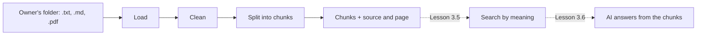

# Lesson 3.4: Text Processing and Comprehensions

**Course:** Python for AI · **Module 3:** RAG and Tools · **Updated:** Oct 2026

> **By the end:** You can find and read files with `pathlib`, build lists and dictionaries in one line with comprehensions, pull the text out of PDFs, clean messy text, and split documents into small overlapping **chunks** that remember where they came from. That is the first step of RAG: the owner's own files become knowledge the AI can use (Lessons 3.5 to 3.7).

---

## 1. Mental Model: Index Cards from a Messy Folder

An owner hands you a folder: a menu, a policy page, a catering brochure as a PDF, an old Word file and a scanned receipt. Before anyone can quickly find "what is the refund policy?", you copy the useful parts onto **index cards**: short, clean, one topic each, with the file name written in the corner.



| Step | Why the AI needs it |
|---|---|
| **Load** | The AI cannot open files; Python reads them into text |
| **Clean** | Page footers, extra spaces and broken lines waste tokens and confuse search |
| **Split** | A whole manual is too long to send on every question; small chunks let you send only the relevant ones |
| **Remember the source** | So the answer can say "see the catering guide, page 2", and you can check it |

**Data preparation decides most of the quality of a RAG system.** A great model with badly cut chunks still gives bad answers.

---

## 2. `pathlib`: Files the Professional Way

In Lesson 3.1 you copied `Path(__file__).parent.parent` "for now". Here is what it means.

Create a folder `code/knowledge/` with the owner's files. For the Sweet Crumbs example, `menu.txt`:

```text
SWEET CRUMBS MENU   (updated October 2026)

Chocolate cake    1,500 PKR
Rich chocolate sponge with fudge icing. Serves 6 to 8.

Cupcake    250 PKR
Vanilla or chocolate, baked every morning.

Brownie    300 PKR
Fudgy, with walnuts. Ask for a nut-free brownie.

Mango tart    coming soon
```

and `policies.md`:

```markdown
# Sweet Crumbs Policies

## Opening hours
We are open 9 am to 10 pm, every day, including public holidays.

## Delivery
Delivery inside Lahore costs 200 PKR.
Delivery is free for orders from 3,000 PKR.
We do not deliver outside Lahore.


## Refunds and complaints
If your order is wrong or late by more than 1 hour, call us within 24 hours
for a full refund or a free replacement. Custom cakes cannot be refunded once
baking has started.

## Allergies
All products are made in a kitchen that uses nuts, eggs, milk and wheat.
```

Add a PDF of your own (any brochure or price list: in Word or Google Docs, use "Save as PDF" or "Download as PDF") as `catering.pdf`.

`code/lesson_3_4_paths.py`

```python
"""Lesson 3.4: pathlib: find, inspect and read files the professional way."""

from pathlib import Path

folder = Path("knowledge")                     # a path, not just text
menu = folder / "menu.txt"                     # "/" joins paths on every operating system

print(menu)                                    # knowledge/menu.txt (knowledge\menu.txt on Windows)
print(menu.exists(), menu.name, menu.stem, menu.suffix)   # True menu.txt menu .txt
print(menu.read_text(encoding="utf-8")[:22])   # SWEET CRUMBS MENU

for path in sorted(folder.glob("*")):          # every file in the folder
    print(f"{path.name:<22} {path.suffix:<6} {path.stat().st_size:>6} bytes")

here = Path(__file__).parent                   # the folder THIS script is in
print(here.name)                               # code
```

| Part | Meaning |
|---|---|
| `Path("knowledge")` | A path object, not just text: it knows about folders and files |
| `folder / "menu.txt"` | Joins paths with the right separator for Windows, macOS and Linux |
| `.exists()`, `.is_dir()` | Is it there? Is it a folder? |
| `.name`, `.stem`, `.suffix` | `menu.txt`, `menu`, `.txt` |
| `.read_text(encoding="utf-8")` | Open, read and close in one line |
| `.glob("*.pdf")` | Every matching file in the folder (`"*"` for all) |
| `Path(__file__).parent` | The folder of the script itself, so the code works from any folder |

**Paths are relative to where you run from** (Lesson 2.6). Run this from `code/`: `cd code`, then `uv run lesson_3_4_paths.py`.

---

## 3. Comprehensions: Build a List or Dictionary in One Line

`code/lesson_3_4_comprehensions.py`

```python
"""Lesson 3.4: list and dict comprehensions: build a new list or dictionary in one line."""

prices = {"chocolate cake": 1500, "cupcake": 250, "brownie": 300, "mango tart": 0}

# The long way (Lesson 2.4)
for_sale = []
for name, price in prices.items():
    if price > 0:
        for_sale.append(name)

# The same with a list comprehension: [what for each in where if condition]
for_sale = [name for name, price in prices.items() if price > 0]
print(for_sale)                        # ['chocolate cake', 'cupcake', 'brownie']

lines = ["  Cupcake 250 PKR  ", "", "   ", "Brownie 300 PKR"]
clean = [line.strip() for line in lines if line.strip() != ""]
print(clean)                           # ['Cupcake 250 PKR', 'Brownie 300 PKR']

# A dict comprehension: {key: value for each in where if condition}
RATE_USD = 0.003553                    # example rate, Lesson 3.3 gets the real one
in_usd = {name: round(price * RATE_USD, 2) for name, price in prices.items() if price > 0}
print(in_usd)                          # {'chocolate cake': 5.33, 'cupcake': 0.89, 'brownie': 1.07}

lengths = {word: len(word) for word in ["cake", "brownie", "tart"]}
print(lengths)                         # {'cake': 4, 'brownie': 7, 'tart': 4}
```

```text
[ what to keep   for each item in the collection   if a condition ]
{ key: value    for each item in the collection   if a condition }
```

| You want | Comprehension |
|---|---|
| Clean every line | `[line.strip() for line in lines]` |
| Keep only some | `[n for n in names if n != ""]` |
| A lookup table | `{name: len(name) for name in names}` |
| Each value once (a **set**) | `{chunk["source"] for chunk in chunks}` |
| Add them up | `sum(len(text) for text in texts)` |

**When not to use one:** if it does not fit on one readable line, or it needs `try / except`, use a normal `for` loop. Readable beats clever.

---

## 4. Cleaning Text

Text from real files is messy: double spaces, lines broken in the middle of a sentence, page footers. `code/lesson_3_4_clean.py`

```python
"""Lesson 3.4: clean messy text before an AI ever sees it."""


def is_noise(line: str) -> bool:
    """True for lines that carry no meaning, like 'Page 2 of 3' footers."""
    words = line.lower().split()
    return len(words) in (2, 4) and words[0] == "page" and words[1].isdigit()


def clean_text(text: str) -> str:
    """Remove footers, extra spaces and extra blank lines, but keep paragraphs."""
    lines = [line for line in text.splitlines() if not is_noise(line)]
    paragraphs = "\n".join(lines).split("\n\n")
    # " ".join(p.split()) squeezes every run of spaces, tabs and line breaks into one space
    paragraphs = [" ".join(p.split()) for p in paragraphs]
    return "\n\n".join(p for p in paragraphs if p != "")


messy = """Delivery inside Lahore    costs 200 PKR.
Delivery is free
for orders from 3,000 PKR.


Page 2 of 3
Refunds within   24 hours."""

print(clean_text(messy))
# Delivery inside Lahore costs 200 PKR. Delivery is free for orders from 3,000 PKR.
#
# Refunds within 24 hours.

assert is_noise("Page 2 of 3") and is_noise("page 7") and not is_noise("Page through the menu")
print("clean_text: tests passed")
```

| Trick | What it does |
|---|---|
| `text.splitlines()` | One string per line |
| `" ".join(p.split())` | `.split()` with no argument splits on **any** whitespace, so this squeezes every run of spaces, tabs and line breaks into a single space |
| `.split("\n\n")` | Paragraphs are separated by an empty line; keeping them lets the splitter cut **between** topics |
| `is_noise(line)` | A small, tested rule for one kind of junk. Add your own: copyright lines, phone footers |

**Do not over-clean.** Never remove numbers, prices or names. If in doubt, keep it.

---

## 5. Reading PDFs

```bash
uv add pypdf
```

`code/lesson_3_4_pdf.py`

```python
"""Lesson 3.4: read the text out of a PDF, page by page."""

from pathlib import Path

from pypdf import PdfReader

path = Path("knowledge/catering.pdf")
reader = PdfReader(path)
print(f"{path.name}: {len(reader.pages)} pages")

for number, page in enumerate(reader.pages, start=1):
    text = page.extract_text()
    if text.strip() == "":
        # A scanned PDF is a photo of text: there is nothing to extract without OCR
        print(f"Page {number}: no text found (scanned?)")
    else:
        print(f"Page {number}: {len(text)} characters")
        print(text[:80])
```

**Output**
```text
catering.pdf: 2 pages
Page 1: 244 characters
Sweet Crumbs Catering Guide
We cater weddings, birthdays and office events acros
Page 2: 209 characters
Packages
Party Box (20 cupcakes and 10 brownies): 7,500 PKR.
Office Box (40 cupc
```

| PDF type | What `extract_text()` gives | What to do |
|---|---|---|
| Made from Word, Google Docs, a website | The text | Use it |
| **Scanned** (a photo of paper) | An empty string | Skip it and tell the owner; reading it needs **OCR** (optical character recognition), a later topic |
| Password-protected or damaged | An error (`PdfReadError`) | Skip it with a clear message |
| Tables and columns | Text, but sometimes in a strange order | Check a sample by eye before trusting it |

---

## 6. Chunking: Why Small Pieces, and How

**Why chunk at all?** Lesson 2.2: everything you send costs tokens and time, and a model's context window is limited. A 40-page manual on every question is slow, expensive and buries the one sentence that matters. Small chunks let Lesson 3.5 find and send **only the 3 or 4 that answer the question**.

| Chunk size | Good for | Risk |
|---|---|---|
| Too small (under 100 characters) | Very precise matches | A fact is cut away from its meaning ("3 days notice" without "for 20 people") |
| About 300 to 1,000 characters | Most business documents | A good default to start with |
| Too large (several pages) | Long, connected explanations | Search becomes vague and every answer costs more |

**Overlap** repeats the end of one chunk at the start of the next, so a sentence cut at the border still appears whole in one of them.

`code/lesson_3_4_chunks.py`

```python
"""Lesson 3.4: split a long text into small, overlapping chunks."""

from langchain_text_splitters import RecursiveCharacterTextSplitter

text = (
    "We cater weddings, birthdays and office events across Lahore. "
    "Orders for 20 people or more need 3 days notice. "
    "A 30 percent advance payment confirms the booking. "
    "Custom cakes start at 4,500 PKR for 2 kg. "
    "Cancellations more than 48 hours before the event get a full refund of the advance."
)

# 1. By hand: chunks of 20 words, each starting 15 words after the last (5 words overlap)
words = text.split()
size, overlap = 20, 5
chunks = [" ".join(words[start:start + size]) for start in range(0, len(words), size - overlap)]
for number, chunk in enumerate(chunks, start=1):
    print(f"{number}: {chunk}")

# 2. The professional way: split on paragraphs, then lines, then words, never mid-word
splitter = RecursiveCharacterTextSplitter(chunk_size=120, chunk_overlap=30)
for number, chunk in enumerate(splitter.split_text(text), start=1):
    print(f"[{number}] ({len(chunk)} chars) {chunk}")
```

**Output**
```text
1: We cater weddings, birthdays and office events across Lahore. Orders for 20 people or more need 3 days notice. A
2: need 3 days notice. A 30 percent advance payment confirms the booking. Custom cakes start at 4,500 PKR for 2
3: at 4,500 PKR for 2 kg. Cancellations more than 48 hours before the event get a full refund of the
4: a full refund of the advance.
[1] (115 chars) We cater weddings, birthdays and office events across Lahore. Orders for 20 people or more need 3 days notice. A 30
[2] (117 chars) more need 3 days notice. A 30 percent advance payment confirms the booking. Custom cakes start at 4,500 PKR for 2 kg.
[3] (112 chars) start at 4,500 PKR for 2 kg. Cancellations more than 48 hours before the event get a full refund of the advance.
```

**Compare them:** the hand-made chunker is one comprehension and easy to understand, but it leaves a tiny last chunk (`a full refund of the advance.`) that adds almost nothing. The `RecursiveCharacterTextSplitter` tries paragraph breaks first, then lines, then spaces, and never cuts a word. Use the hand-made one to **understand** chunking; use the splitter in real projects.

```bash
uv add langchain-text-splitters
```

`chunk_size` and `chunk_overlap` are counted in **characters**, not tokens: 500 characters is about 125 tokens (Lesson 1.1).

---

## 7. Mini Build: A Document Loader for the Owner's Files

Two upgrades to the Lesson 3.1 package: chunk settings in `config.py`, and a new `loader.py`.

### Step 1: add to `code/sweet_crumbs/config.py` (above the web API settings)

```python
# The owner's documents, and how big each chunk is (in characters) for the AI
KNOWLEDGE_DIR = Path(__file__).parent.parent / "knowledge"
CHUNK_SIZE = int(os.getenv("CHUNK_SIZE", "500"))
CHUNK_OVERLAP = int(os.getenv("CHUNK_OVERLAP", "100"))
```

### Step 2: `code/sweet_crumbs/loader.py`

```python
"""Document loader: read the owner's files, clean the text, and split it into chunks.

Supports .txt, .md and .pdf. Every chunk remembers where it came from (file and
page), so in Lesson 3.6 the AI can say which document its answer is based on.
"""

import logging
from pathlib import Path

from langchain_core.documents import Document
from langchain_text_splitters import RecursiveCharacterTextSplitter
from pypdf import PdfReader
from pypdf.errors import PdfReadError

from sweet_crumbs.config import CHUNK_OVERLAP, CHUNK_SIZE, KNOWLEDGE_DIR

# pypdf prints warnings for every damaged file; our own "Skipped" lines are clearer
logging.getLogger("pypdf").setLevel(logging.ERROR)

TEXT_TYPES = (".txt", ".md")
SUPPORTED = TEXT_TYPES + (".pdf",)


def is_noise(line: str) -> bool:
    """True for lines that carry no meaning, like 'Page 2 of 3' footers."""
    words = line.lower().split()
    return len(words) in (2, 4) and words[0] == "page" and words[1].isdigit()


def clean_text(text: str) -> str:
    """Remove footers, extra spaces and extra blank lines, but keep paragraphs."""
    lines = [line for line in text.splitlines() if not is_noise(line)]
    paragraphs = "\n".join(lines).split("\n\n")
    paragraphs = [" ".join(p.split()) for p in paragraphs]
    return "\n\n".join(p for p in paragraphs if p != "")


def read_file(path: Path) -> list[Document]:
    """Read one file into Documents: one for a text file, one per page for a PDF."""
    if path.suffix.lower() in TEXT_TYPES:
        text = clean_text(path.read_text(encoding="utf-8"))
        if text == "":
            return []
        return [Document(page_content=text, metadata={"source": path.name})]
    pages = PdfReader(path).pages
    documents = [
        Document(page_content=clean_text(page.extract_text()), metadata={"source": path.name, "page": number})
        for number, page in enumerate(pages, start=1)
    ]
    # Scanned pages have no text layer: drop them instead of sending empty chunks to the AI
    return [document for document in documents if document.page_content != ""]


def load_folder(folder: Path = KNOWLEDGE_DIR) -> tuple[list[Document], list[str]]:
    """Read every supported file in a folder. Returns (documents, reasons files were skipped)."""
    documents = []
    skipped = []
    for path in sorted(folder.glob("*")):
        if path.is_dir() or path.name.startswith("."):
            continue
        if path.suffix.lower() not in SUPPORTED:
            skipped.append(f"{path.name}: {path.suffix} files are not supported yet")
            continue
        try:
            found = read_file(path)
        except UnicodeDecodeError:
            skipped.append(f"{path.name}: not saved as UTF-8 text")
            continue
        except PdfReadError:
            skipped.append(f"{path.name}: damaged or password-protected PDF")
            continue
        if len(found) == 0:
            skipped.append(f"{path.name}: no text found (a scanned PDF needs OCR)")
        documents.extend(found)  # extend adds every item of a list, append would add the list itself
    return documents, skipped


def split_documents(documents: list[Document]) -> list[Document]:
    """Split documents into overlapping chunks, and number every chunk."""
    # Overlap repeats the end of one chunk at the start of the next, so a sentence cut in two still makes sense
    splitter = RecursiveCharacterTextSplitter(chunk_size=CHUNK_SIZE, chunk_overlap=CHUNK_OVERLAP)
    chunks = splitter.split_documents(documents)
    for number, chunk in enumerate(chunks, start=1):
        chunk.metadata["chunk"] = number
    return chunks


if __name__ == "__main__":
    assert is_noise("Page 2 of 3") and is_noise("page 7") and not is_noise("Page through the menu")
    assert clean_text("a   b\n\n\n\nPage 1 of 2\nc") == "a b\n\nc"
    assert clean_text("   \n\n  ") == ""
    print("loader.py: all tests passed")
```

| Part | Why |
|---|---|
| `Document(page_content=..., metadata={...})` | LangChain's standard "piece of text + where it came from". Lessons 3.5 and 3.6 use the same class |
| `metadata={"source": ..., "page": ...}` | Every chunk keeps its file name and page: answers can cite them |
| `-> tuple[list[Document], list[str]]` | The function returns **two** things; the caller unpacks them: `documents, skipped = load_folder()` |
| `documents.extend(found)` | Adds every item of `found`; `append` would add the whole list as one item |
| A list of `skipped` reasons | The owner learns **which** files the AI cannot read, and why, instead of silent gaps |
| `logging.getLogger("pypdf")...` | pypdf prints its own warnings for damaged files; our "Skipped" lines are clearer |
| `chunk.metadata["chunk"] = number` | A number for each chunk, so you can point at one in testing |

### Step 3: `code/lesson_3_4_loader.py`

```python
"""Lesson 3.4: load the owner's files, split them into chunks, and save them for Lesson 3.5.

Run: uv run lesson_3_4_loader.py
"""

import json

from sweet_crumbs.config import CHUNK_OVERLAP, CHUNK_SIZE, KNOWLEDGE_DIR
from sweet_crumbs.loader import load_folder, split_documents

documents, skipped = load_folder()
chunks = split_documents(documents)

print(f"Knowledge folder: {KNOWLEDGE_DIR.name}/ | chunk size {CHUNK_SIZE}, overlap {CHUNK_OVERLAP}")
print("=" * 60)

sources = sorted({chunk.metadata["source"] for chunk in chunks})       # a set comprehension: each name once
per_source = {source: len([c for c in chunks if c.metadata["source"] == source]) for source in sources}
for source, count in per_source.items():
    print(f"{source:<24} chunks: {count}")
for reason in skipped:
    print(f"Skipped  {reason}")

print("=" * 60)
total_characters = sum(len(chunk.page_content) for chunk in chunks)
print(f"{len(documents)} documents -> {len(chunks)} chunks, about {round(total_characters / 4):,} tokens in total")

example = chunks[0]
print(f"\nChunk 1 from {example.metadata['source']}:\n{example.page_content[:200]}")

# Save plain dictionaries (Lesson 2.6): Lesson 3.5 turns these chunks into a search index
rows = [{"text": chunk.page_content, **chunk.metadata} for chunk in chunks]
with open("chunks.json", "w", encoding="utf-8") as f:
    json.dump(rows, f, indent=2, ensure_ascii=False)
print(f"\nSaved {len(rows)} chunks to chunks.json")
```

```bash
cd code
uv run python -m sweet_crumbs.loader   # loader.py: all tests passed
uv run lesson_3_4_loader.py
```

**Output** (with a Word file and a scanned PDF also in the folder)
```text
Knowledge folder: knowledge/ | chunk size 500, overlap 100
============================================================
catering.pdf             chunks: 2
menu.txt                 chunks: 1
policies.md              chunks: 2
Skipped  notes.docx: .docx files are not supported yet
Skipped  scanned-receipt.pdf: no text found (a scanned PDF needs OCR)
============================================================
4 documents -> 5 chunks, about 305 tokens in total

Chunk 1 from catering.pdf:
Sweet Crumbs Catering Guide We cater weddings, birthdays and office events across Lahore. Orders for 20 people or more need 3 days notice. A 30 percent advance payment confirms the booking. Custom cak

Saved 5 chunks to chunks.json
```

`chunks.json` is the bridge to Lesson 3.5, where every chunk gets turned into numbers that let you search by meaning. If the owner's documents are private, add `code/chunks.json` and the `knowledge/` folder to `.gitignore`.

**Try it in class:**
1. Change `CHUNK_SIZE=150` and `CHUNK_OVERLAP=30` in `.env`, run again: how many chunks now? Read two of them: do they still make sense on their own?
2. Add a page-footer line like `Page 3 of 9` to `menu.txt`: it must not appear in any chunk
3. Put a scanned PDF (a phone photo saved as PDF) in the folder: it must appear under "Skipped"
4. Open `chunks.json` and find the chunk that answers "how much notice for 20 people?" by eye. In Lesson 3.5, code will find it for you

---

## 8. Common Errors and Traps

| Problem | Cause | Fix |
|---|---|---|
| `FileNotFoundError: ... knowledge/menu.txt` | Ran from the wrong folder, or a typo | `cd code` first, or build paths from `Path(__file__).parent` |
| `glob` finds nothing | Wrong folder, or a pattern like `"*.PDF"` vs `"*.pdf"` | Print `folder.resolve()`; compare `path.suffix.lower()` |
| `UnicodeDecodeError: 'utf-8' codec can't decode byte ...` | The file was saved in another encoding (old Windows Notepad) | Re-save it as UTF-8, or skip it with a clear message |
| `extract_text()` returns `""` | A scanned PDF: an image, not text | Skip and report it; OCR is a separate step |
| `pypdf.errors.PdfReadError` or `PdfStreamError` | Damaged or password-protected PDF | Catch `PdfReadError` (it covers both) and report it |
| `ModuleNotFoundError: No module named 'langchain_text_splitters'` | Package not installed | `uv add langchain-text-splitters` (the import uses `_`, the package uses `-`) |
| Every chunk is one huge block | Text has no paragraph breaks left after cleaning | Keep `\n\n` between paragraphs; the splitter needs them |
| Chunks cut in the middle of a word | A hand-made character slicer | Split on words, or use `RecursiveCharacterTextSplitter` |
| `chunk_overlap` larger than `chunk_size` | Settings mix-up | Overlap is usually 10 to 20 percent of the size |
| A comprehension nobody can read | Too much in one line | Use a normal `for` loop |

---

## 9. Job & Client Angle

- **Every RAG project starts here.** Clients have folders of PDFs, Word files, WhatsApp exports and price lists. Turning that into clean, sourced chunks is paid work in its own right.
- **The "Skipped" report builds trust.** Telling the owner "these 3 files are scanned, so the bot cannot read them" is far better than a bot that silently knows nothing about them.
- **Privacy:** owners' documents may contain customer names, phone numbers or salaries. Ask what may be used, keep the files out of public repos, and use a local model for private data (Lesson 1.2).

---

## 10. Your Task (self-create)

Build a document loader for **your own** business: a `knowledge/` folder with at least 3 real files (including one PDF), a `loader.py` in your package that loads, cleans and chunks them with the source and page in every chunk, a report of what was loaded and skipped, and `chunks.json` saved for Lesson 3.5.

**Full requirements, expected output, stretch goal and marking:** [Task 3.4: Document Loader](../assessments/module-3/checkpoint-1-code-tasks.md#task-34-document-loader)

Run it with `uv run lesson_3_4_loader.py` from the `code` folder, then push (without private documents).

**Checkpoint 1 reached (Lessons 3.1 to 3.4).** Your agent is now organised, uses validated data, fetches live information, and has the owner's documents ready as chunks. Next comes the Checkpoint 1 Quick Check and project.

---

## Key Takeaways

- `pathlib.Path` joins, checks, lists (`glob`) and reads files on every operating system
- A **comprehension** builds a list `[...]`, dictionary `{k: v ...}` or set `{...}` in one readable line; use a loop when it stops being readable
- `pypdf` reads text page by page; scanned and damaged PDFs must be skipped **and reported**
- Clean text without losing facts: remove footers and extra whitespace, keep paragraphs, numbers and names
- Split into overlapping **chunks** that keep their `source` and `page`; that is what RAG searches in the next lessons

### Quick Check
1. What does `[p.stem for p in Path("knowledge").glob("*.pdf")]` give you?
2. Why does `extract_text()` return an empty string for some PDFs, and what should your loader do?
3. Why do chunks overlap, and why must each chunk remember its source?

---

## Must-Have Resources

- Python `pathlib`: https://docs.python.org/3/library/pathlib.html
- Python tutorial, list comprehensions: https://docs.python.org/3/tutorial/datastructures.html#list-comprehensions
- pypdf, extracting text: https://pypdf.readthedocs.io/en/stable/user/extract-text.html
- LangChain text splitters: https://docs.langchain.com/oss/python/integrations/splitters
- LangChain, build a knowledge base (load and split a PDF): https://docs.langchain.com/oss/python/langchain/knowledge-base

**Next:** Lesson 3.5: Embeddings and Semantic Search
